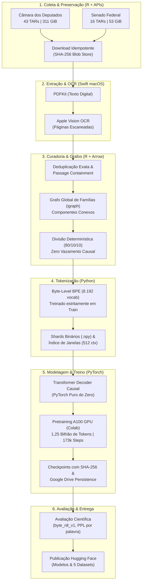

# 🏛️ LLM Legislativo Brasileiro

> **Corpus Oficial em Larga Escala e Pré-treinamento de Modelo de Linguagem Causal (Transformer) Construído 100% do Zero em PyTorch Puro.**

[](https://www.python.org/)
[](https://pytorch.org/)
[](https://www.r-project.org/)
[](https://developer.apple.com/documentation/vision)
[](https://huggingface.co/BaruqRodrigues/llm-legislativo)
[](https://huggingface.co/BaruqRodrigues)
[](LICENSE)

---

## 📌 Visão Geral

O **LLM Legislativo Brasileiro** é um projeto de pesquisa e engenharia de inteligência artificial de ponta a ponta. Seu objetivo é estruturar o acervo histórico oficial do Congresso Nacional brasileiro (Câmara dos Deputados e Senado Federal) em dados abertos auditáveis e treinar um modelo de linguagem causal autônomo, **implementado do zero sem uso de pesos pré-treinados, sem dependência de APIs fechadas e sem caixas-pretas como o Hugging Face Trainer**.

Todo o pipeline foi concebido sob princípios estritos de **ciência aberta**, **reprodutibilidade**, **integridade criptográfica (SHA-256)** e **isolamento causal estrito (zero data leakage entre splits de treino e teste)**.

---

## 🚀 Destaques do Projeto

* 📦 **Volume de Dados Extraordinário:**
  * **+360 GiB** de dados oficiais em arquivos brutos (TARs compactados e documentos primários).
  * **Câmara dos Deputados:** 43 arquivos TARs catalogados (**311,38 GiB**, 856.902 registros internos verificados).
  * **Senado Federal:** 16 lotes documentais (**53,36 GiB**) com processos e diários.
  * **+930.000 documentos e versões substantivas** (Projetos de Lei, PLPs, PECs, emendas, votos, relatórios, pareceres de comissões, substitutivos, redações finais e anais).
* 🌐 **Ecossistema Público no Hugging Face Hub:**
  * Publicação aberta de **5 Datasets Oficiais** cobrindo desde os TARs brutos até as matrizes curadas em formato Apache Parquet.
  * Publicação aberta do **Modelo de Linguagem Causal** em formato `safetensors`, com metadados de treino, tokenizer e código de inferência autônomo.
* 🧠 **Tokenização Própria Byte-Level BPE:**
  * Tokenizer com vocabulário de **8.192 tokens**, treinado **estritamente sobre o split de treino** para evitar contaminação lexical. Round-trip exato UTF-8 garantido.
* ⚙️ **Transformer Decoder Educacional Explícito:**
  * Implementação matemática pura em PyTorch: multi-head causal self-attention, embeddings amarrados (*weight tying*), ativações GELU e projeções explícitas.
  * **Acumulação Exata de Gradientes:** Compensação analítica da perda por alvos válidos ($\sum CE_k / N_{\text{total}}$), neutralizando desvios induzidos por sequências heterogêneas com *padding*.
* ⚡ **Treinamento em Escala em GPU NVIDIA A100 (Google Colab):**
  * **173.209 passos de otimização (updates)** contínuos (~20h04 na GPU A100-SXM4-40GB).
  * **1.246.588.497 tokens vistos** ao longo do pré-treinamento integral.
  * Persistência resiliente com checkpoints criptograficamente auditados no Google Drive.
* 📊 **Avaliação Científica Rigorosa:**
  * Protocolo `byte_nll_v1` padronizado (0,729 nats/byte; 1,052 bits/byte no split de teste independente).

---

## 🗺️ Mapa de Artefatos no Hugging Face Hub

Todos os artefatos gerados pelo projeto estão disponibilizados publicamente para a comunidade de pesquisa:

| Tipo | Repositório no Hub | Descrição |
|:---:|:---|:---|
| 🤖 **Modelo** | [**BaruqRodrigues/llm-legislativo**](https://huggingface.co/BaruqRodrigues/llm-legislativo) | Pesos `model.safetensors`, tokenizer, configurações, métricas e inferência pura. |
| 🗄️ **Dataset** | [**BaruqRodrigues/corpus-legislativo-pretraining**](https://huggingface.co/datasets/BaruqRodrigues/corpus-legislativo-pretraining) | Release unificada curada em Parquet (splits de treino/val/teste por família) e tokenizer. |
| 🏛️ **Dataset** | [**BaruqRodrigues/camara-corpus-raw**](https://huggingface.co/datasets/BaruqRodrigues/camara-corpus-raw) | 43 arquivos TARs brutos da Câmara dos Deputados (311+ GiB) com manifestos SHA-256. |
| 🏛️ **Dataset** | [**BaruqRodrigues/camara-corpus-text**](https://huggingface.co/datasets/BaruqRodrigues/camara-corpus-text) | 21.947 lotes com extração textual estruturada e verificação de qualidade. |
| 🏛️ **Dataset** | [**BaruqRodrigues/senado-corpus-raw**](https://huggingface.co/datasets/BaruqRodrigues/senado-corpus-raw) | Inventário e dados primários do Senado Federal (53+ GiB). |
| 🏛️ **Dataset** | [**BaruqRodrigues/senado-corpus-text**](https://huggingface.co/datasets/BaruqRodrigues/senado-corpus-text) | Documentos e páginas curadas do Senado em formato colunar Parquet. |

---

## 🏗️ Arquitetura do Pipeline

O pipeline integra linguagens especializadas para máxima eficiência em cada camada:



---

## 🔬 Detalhamento Técnico das Etapas

### 1. Ingestão e Governança Documental
Ao contrário de recortes parciais comuns na literatura (que costumam filtrar apenas versões iniciais de PLs recentes), este projeto mapeia a **integralidade da produção legislativa**:
* **Categorias Elegíveis:** Proposições principais (PL, PLP, PEC, PDC, MPV), emendas de plenário e comissão, pareceres de relatores, substitutivos globais, redações finais, votos em separado e anais das sessões.
* **Isolamento de Dados:** Os dados brutos e shards residem fora do controle de versão Git, mantendo apenas metadados e esquemas leves versionados.

### 2. Extração Nativa e OCR Seletivo no macOS
* Adaptador nativo compilado em **Swift** operando diretamente no subsistema de renderização da Apple.
* **Leitura Híbrida Inteligente:** Documentos com texto vetorial embutido são extraídos diretamente via **PDFKit**; páginas digitalizadas ou com densidade insuficiente de caracteres acionam automaticamente o **Apple Vision OCR** em modo de alta acurácia.

### 3. Curadoria e Partição Causal (Zero Leakage)
* **Deduplicação Multinível:** Deduplicação exata por SHA-256 e detecção de inclusão de texto (*passage containment*), preservando ao mesmo tempo variações operacionais jurídicas substantivas (*"revoga-se"* vs *"institui-se"*).
* **Grafo Global de Famílias Legislativas:** Utilizando a biblioteca `igraph`, cada proposição, suas emendas, seus pareceres e seus substitutivos são vinculados ao mesmo componente conexo (`family_id`).
* **Divisão de Splits sem Vazamento:** Os splits (80% treino, 10% validação, 10% teste) são calculados por *hashing* determinístico do `family_id`. **Nenhum documento de uma mesma família tramitada divide conjuntos de treino e teste.**

### 4. Tokenizador Byte-Level BPE
* Vocabulário otimizado de **8.192 tokens**.
* Treinado **exclusivamente** sobre o split de treino da release curada, eliminando contaminação prévia de vocabulário do conjunto de teste.
* Suporte completo a caracteres especiais, símbolos legislativos (`§`, `º`, `ª`, `Art.`), acentuação do português e numerais.

### 5. Arquitetura do Modelo (Transformer Decoder Causal)
Implementação explícita em PyTorch (`src/legislm/model/`):
* **Configuração do Modelo:**
  * Camadas (*layers*): 6
  * Cabeças de atenção (*attention heads*): 6
  * Dimensão oculta (*d_model*): 384
  * Janela de contexto: 512 tokens
  * Vocabulário: 8.192 tokens
  * Compartilhamento de pesos (*weight tying*) entre matriz de embedding e projeção linear de saída.
* **Acumulação Analítica de Gradientes:**
  Perda computada como a soma da Cross-Entropy de cada micro-lote dividida estritamente pelo número total de alvos válidos de todo o ciclo de atualização:
  $$\mathcal{L}_{\text{update}} = \frac{\sum_{k=1}^K \text{CE}_k}{\sum_{k=1}^K N_k^{\text{valid}}}$$

### 6. Treinamento Integral e Persistência
* **Ambiente:** Google Colab Pro / Compute Engine com GPU **NVIDIA A100-SXM4-40GB** e 83,5 GiB de RAM de sistema.
* **Hiperparâmetros:** Otimizador AdamW ($\beta_1=0.9, \beta_2=0.95$, weight decay 0.01), scheduler cossenoidal com aquecimento linear (*warmup* de 2.000 passos), precisão mista FP16 com rastreamento estrito de *overflow*.
* **Resultado:** 173.209 atualizações concluídas com sucesso, registrando perda de validação de `2,2111` e perplexidade de `9,1257`.

### 7. Avaliação Padronizada (`byte_nll_v1`)
Métricas calculadas sobre 71.069 documentos e 482 milhões de bytes no split de teste independente:
* **Perda média por alvo válido:** 2,1065
* **Perplexidade por token:** 8,2197
* **Perplexidade por palavra:** 65,6509
* **NLL Normalizada por Byte (`byte_nll_v1`):**
  * **0,7297 nats/byte** (1,0528 bits/byte) global.
  * Câmara dos Deputados: 0,7049 nats/byte.
  * Senado Federal: 0,8817 nats/byte.

---

## 💻 Estrutura do Repositório

```text
├── AGENTS.md                  # Governança multi-agente e divisão estrita de ownership
├── README.md                  # Apresentação do projeto e documentação consolidada
├── .gitignore                 # Regras estritas de isolamento de binários, pesos e caches
├── pyproject.toml             # Pacote Python 'legislm'
├── requirements-base.lock     # Lockfile Python para dependências base
├── requirements-cpu.lock      # Lockfile Python para execução e testes em CPU
├── renv.lock                  # Lockfile R para reprodutibilidade dos dados
├── schemas/                   # Esquemas Arrow (R) e JSON Schema dos contratos de dados
├── configs/                   # Configurações declarativas (dados, curadoria, treino, colab)
├── R/
│   ├── inventory/             # Coletores oficiais e adaptadores da Câmara e do Senado
│   ├── download/              # Gerenciador de downloads idempotentes e resilientes
│   ├── extraction/            # Adaptador Swift nativo macOS (PDFKit + Apple Vision OCR)
│   └── curation/              # Deduplicação, grafo de famílias e partição de splits
├── src/legislm/               # Pacote Python do modelo de linguagem
│   ├── tokenization/          # BPE byte-level, iteradores de dados e gerador de shards
│   ├── model/                 # Transformer Decoder causal explícito em PyTorch puro
│   ├── training/              # Loop de treino, acumulação de gradientes e persistência
│   ├── colab/                 # Staging em disco local e persistência no Google Drive
│   └── evaluation/            # Avaliação comparativa byte NLL e geração de texto
├── notebooks/                 # Notebooks de execução no Google Colab (piloto e integral A100)
├── scripts/                   # Pontos de entrada executáveis em linha de comando (CLI)
├── tests/                     # Suíte com 135+ testes unitários e contratuais
└── docs/                      # Documentação normativa, contratos e relatórios das frentes
```

---

## 🛠️ Como Executar e Reproduzir

### 1. Clonar o Repositório e Configurar o Ambiente Python

```bash
git clone https://github.com/BaruqueRodrigues/llm-legislativo.git
cd llm-legislativo

# Criar e ativar ambiente virtual
python3 -m venv .venv
source .venv/bin/activate

# Instalar o pacote em modo editável com dependências
pip install -e .
```

### 2. Executar a Suíte de Testes Automatizados

Todos os contratos de modelo, persistência, tokenização e avaliação podem ser validados localmente em CPU:

```bash
pytest tests/ -q
```
*(135 testes passam com 100% de sucesso).*

### 3. Usar o Modelo Treinado para Inferência (PyTorch Puro)

Você pode carregar o modelo treinado diretamente do Hugging Face Hub sem depender de bibliotecas externas complexas:

```python
import torch
from huggingface_hub import hf_hub_download
from safetensors.torch import load_file
from legislm.model.gpt import GPTModel
from legislm.model.config import ModelConfig
from tokenizers import Tokenizer

# 1. Baixar pesos e tokenizer do Hub
weights_path = hf_hub_download(repo_id="BaruqRodrigues/llm-legislativo", filename="model.safetensors")
tokenizer_path = hf_hub_download(repo_id="BaruqRodrigues/llm-legislativo", filename="tokenizer.json")

# 2. Inicializar tokenizer e arquitetura
tokenizer = Tokenizer.from_file(tokenizer_path)
config = ModelConfig(
    vocab_size=8192,
    context_length=512,
    d_model=384,
    n_layers=6,
    n_heads=6,
    tie_embeddings=True
)
model = GPTModel(config)

# 3. Carregar pesos safetensors
state_dict = load_file(weights_path)
model.load_state_dict(state_dict)
model.eval()

# 4. Geração de texto legislativo
prompt = "PROJETO DE LEI Nº , DE 2026\n\nDispõe sobre"
input_ids = torch.tensor([tokenizer.encode(prompt).ids], dtype=torch.long)

with torch.no_grad():
    output_ids = model.generate(
        input_ids,
        max_new_tokens=64,
        temperature=0.7,
        top_k=40,
        eos_token_id=2
    )

print(tokenizer.decode(output_ids[0].tolist()))
```

---

## ⚖️ Nota de Uso Ético e Limitações

Este projeto é um **artefato de pesquisa científica e engenharia educacional**. 
* O modelo aprendeu os padrões estatísticos, jargões formais e a sintaxe documental do processo legislativo brasileiro.
* **Ele não deve ser utilizado como consultor jurídico factual ou ferramenta de decisão normativa:** modelos causais pré-treinados podem alucinar números de leis, inventar ementas ou atribuir conteúdos fictícios a dispositivos vigentes.

---

## 📄 Licença

O código-fonte e as tabelas de metadados deste projeto estão licenciados sob os termos da [Licença MIT](LICENSE). Os documentos e textos legislativos oficiais processados são de domínio público, de acordo com a legislação brasileira (Lei nº 9.610/1998, Art. 8º, IV).
